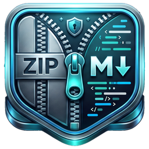

<p align="center">
  
</p>

# ZIPMarkdown

**Exporta un proyecto completo a Markdown apto para una IA, redacta secretos localmente, permite que una IA modifique el proyecto y restaura de forma conservadora los valores protegidos al reconstruirlo.**

> **Beta:** versión del paquete `0.1.0b1`; primera etiqueta pública prevista: `v0.1.0b1`. Mantén una copia de seguridad antes de usar la beta en proyectos críticos.

ZIPMarkdown cierra el ciclo completo sin telemetría:

```text
Proyecto/ZIP → Markdown → cambios de IA → rebase de secretos → proyecto reconstruido
```

## Diferencia principal

No es solo un conversor. Conserva nombres, texto, PDFs, binarios, archivos sensibles y secretos recuperables. El rebase restaura un valor original únicamente si queda un marcador o placeholder seguro; nunca sobrescribe automáticamente un valor real nuevo introducido por la IA.

## Instalación

Compatible con Python 3.10–3.12.

```bash
python -m venv .venv
# Windows: .venv\Scripts\activate
# Linux/macOS: source .venv/bin/activate
python -m pip install .
# o, para una instalación aislada:
pipx install .
```

Desarrollo:

```bash
python -m pip install -e ".[dev]"
```

## Uso por CLI

```bash
zipmarkdown export ./mi-proyecto -o proyecto.md
zipmarkdown export proyecto.zip -o proyecto.md
zipmarkdown export ./mi-proyecto -o proyecto.md --respect-gitignore --verbose
zipmarkdown export ./mi-proyecto -o proyecto.md --strict-secrets
```

Entrega a la IA solo el `.md`; **no compartas ni versiones el `.secrets`**. Revisa siempre el Markdown: el filtrado reduce el riesgo, pero no garantiza detectar todos los secretos.

`--strict-secrets` detiene además la exportación ante asignaciones ambiguas y exige que el ejecutable local `gitleaks` confirme que el Markdown generado está limpio antes de escribir el Markdown o el vault.

Reconstrucción:

```bash
zipmarkdown import editado.md --secrets proyecto.secrets -o reconstruido.zip
zipmarkdown import editado.md --secrets proyecto.secrets --folder -o proyecto-reconstruido
```

Rebase explícito:

```bash
zipmarkdown rebase editado.md --secrets proyecto.secrets -o rebasado.zip
zipmarkdown rebase salida-ia.zip --secrets proyecto.secrets -o rebasado.zip
```

También siguen disponibles `zip_a_markdown.py`, `markdown_a_zip.py` y `rebase_secrets.py`.

## Ejemplo breve

```text
muestra/
├── src/app.py
├── assets/logo.bin
└── .env
```

```bash
zipmarkdown export muestra -o muestra.md
# La IA recibe muestra.md, nunca muestra.secrets.
zipmarkdown import muestra-editada.md --secrets muestra.secrets -o muestra-reconstruida.zip
```

El código queda legible en Markdown; `.env` y el binario permanecen en el vault local y se restauran al final.

## Vault y plataformas

Los identificadores internos `MDTK` se conservan únicamente por compatibilidad histórica; la marca pública es ZIPMarkdown.

| Función | Windows | Linux/macOS |
|---|---:|---:|
| Exportación sin datos protegidos | Sí | Sí |
| Reconstrucción sin vault | Sí | Sí |
| Vault protegido | DPAPI del usuario | Aún no disponible |
| Secretos, PDFs, sensibles y binarios | Sí | La operación se detiene de forma segura |
| Backend simulado para pruebas | Sí | Sí |
| GUI/EXE | Sí | No es objetivo de la beta |

DPAPI usa `CryptProtectData` y `CryptUnprotectData`; el vault suele poder abrirse solo con la misma cuenta de Windows. No se inicializa hasta que hace falta y no se crea un `.secrets` vacío.

### `--no-vault`

No activa almacenamiento en claro. Solo permite exportar cuando no hay secretos, PDFs, binarios, archivos sensibles ni casos que requieran preservar bytes. Si aparecen, ZIPMarkdown se detiene para evitar pérdida silenciosa.

## PDFs, binarios y rebase

El texto del PDF se incorpora al Markdown y el PDF original se guarda en el vault para restaurarlo exactamente. Los binarios no se muestran en Markdown, pero se preservan en el vault. El rebase reconoce marcadores originales y placeholders como `YOUR_API_KEY`, `<token>` y `[REDACTED]`, recupera rutas renombradas solo cuando la coincidencia es única y deja intactos los casos ambiguos o valores reales nuevos.

## Seguridad de ZIP y límites

Valores predeterminados:

- 10.000 entradas;
- 100 MB por archivo descomprimido;
- 1 GB total descomprimido;
- 1 GB máximo de entrada Markdown, comprobado antes del análisis;
- 1.000 páginas PDF;
- rechazo de relaciones de compresión superiores a 100:1.

También se rechazan Zip Slip, rutas absolutas, `..`, unidades de Windows, barras invertidas, nombres reservados, dos puntos, espacios/puntos finales, duplicados, ZIP cifrados y symlinks. Las escrituras principales son atómicas.

## `.gitignore` opcional

`--respect-gitignore` es opt-in. Con `--verbose` se muestra la regla que excluyó cada archivo. `pathspec` implementa las reglas Git; el fallback offline cubre reglas habituales, pero algunos casos extremos pueden diferir. Las exclusiones de seguridad y dependencias se mantienen siempre.

## GUI y EXE de Windows

```bash
zipmarkdown gui
```

El menú de bandeja incluye exportar proyecto/ZIP, importar Markdown, aplicar vault/rebase, abrir la carpeta de salida y consultar el último informe. Arrastrar una carpeta, ZIP o Markdown al EXE inicia el flujo correspondiente. Si el Markdown cambió de nombre, el vault puede seleccionarse manualmente.

Compilación:

```bat
build_exe.bat
```

Genera `dist\ZIPMarkdown.exe` y su SHA-256. El ejecutable **no está firmado con Authenticode**; SmartScreen puede mostrar un aviso por tratarse de un binario nuevo y sin firma.

## Pruebas

```bash
python -m compileall -q .
python -m pytest --cov --cov-fail-under=80
python -m ruff check .
python -m build
```

CI prueba Python 3.10, 3.11 y 3.12 en Linux y Windows. Windows ejecuta pruebas DPAPI reales y construye el EXE. El workflow de release se dispara con etiquetas `v*` (empezando por `v0.1.0b1`).

Repositorio e incidencias: https://github.com/javierstampa/ZIPMarkdown (configurado en `pyproject.toml`).

## Limitaciones y modelo de seguridad

- La detección de secretos no es infalible: revisa el Markdown.
- El rebase prioriza no sobrescribir valores nuevos.
- No hay OCR para PDFs escaneados.
- Keychain, Secret Service y vault por contraseña quedan en el roadmap.
- Las pruebas reales de GUI, DPAPI y EXE requieren Windows.
- No publiques una vulnerabilidad; sigue [SECURITY.md](SECURITY.md).

Consulta [CONTRIBUTING.md](CONTRIBUTING.md), [CHANGELOG.md](CHANGELOG.md) y la [licencia MIT](LICENSE). Roadmap breve: backends nativos para macOS/Linux, vault portable opcional, OCR, firma de ejecutables e informes dry-run más ricos.
